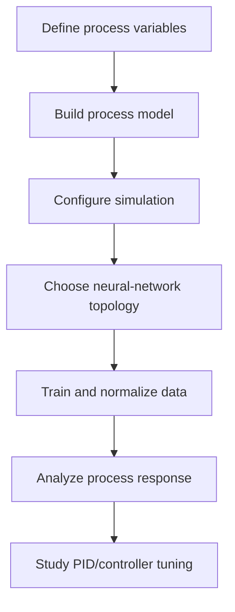

<div align="center">

# RNA-PID — Neural Networks & Process Control

**An experimental study connecting process modeling, neural networks, and classical control.**


</div>

## Contents

- [Overview](#overview)
- [Study workflow](#study-workflow)
- [Modeling topics](#modeling-topics)
- [Repository map](#repository-map)
- [Getting started](#getting-started)
- [Current scope](#current-scope)
- [Reproducibility checklist](#reproducibility-checklist)
- [License](#license)

## Overview

RNA-PID is a control-engineering study exploring how neural-network models can be used alongside process simulation and PID-controller design. The repository contains experiment notes, process variables, and supporting materials for a magnetic-levitation bench.

It is best understood as a research workspace and documentation of a study — not as a packaged, validated controller.

## Study workflow



## Modeling topics

The project notes cover:

- Process variables and model parameters
- MATLAB scripting and Simulink simulation
- Neural-network inputs, outputs, hidden layers, activation functions, and normalization
- Training parameters and evaluation metrics
- Transfer functions and controller tuning
- Error, control signal, and system output

## Repository map

```text
RNA_PID/
├── bancada_maglev_h/          # Magnetic-levitation bench materials
├── matTrab/                   # Supporting study material
├── variaveis_do_processo.txt  # Process and model notes
└── README.md
```

## Getting started

1. Read [variaveis_do_processo.txt](variaveis_do_processo.txt) to understand the documented variables and parameters.
2. Inspect [bancada_maglev_h/](bancada_maglev_h/) and [matTrab/](matTrab/) to identify the experiment files.
3. Open the relevant MATLAB/Simulink files in a compatible environment, if present.

The repository does not currently provide a verified dependency list, software-version matrix, or one-command reproduction procedure.

## Current scope

The available material documents a study workflow and experimental context. It does not establish that a trained network, tuned PID controller, or complete magnetic-levitation experiment can be reproduced directly from a clean checkout.

## Reproducibility checklist

For a reproducible engineering report, record the plant model, sampling period, sensor and actuator characteristics, network topology, training data, normalization, controller gains, and test conditions.

## License

This project is licensed under the **GNU General Public License v3.0 only (GPL-3.0-only)**. You may use, study, modify, and redistribute this project under the terms of the license.

See [LICENSE](LICENSE) for the complete license text. Third-party components and assets remain subject to their own licenses and notices.
